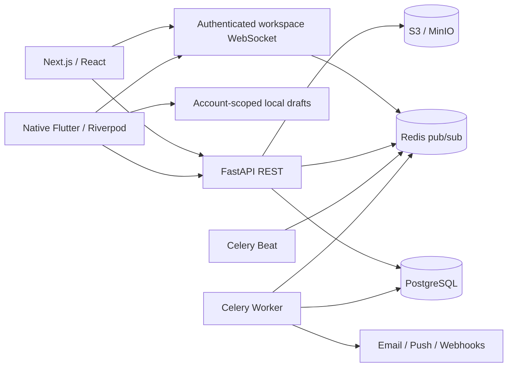

# TaskPilot engineering case study

> Portfolio case study. This describes the code and design, not a claim of production deployment or physical-device certification.

## Problem and audience

TaskPilot helps small product and engineering teams coordinate tasks, ownership, due dates, comments, and progress without losing work during intermittent connectivity. The hardest scenario is not task creation: it is a collaborator changing a task on the web while another person edits the same task offline on a phone.

## System architecture

FastAPI provides typed request validation, async database access, and explicit workspace/project permission dependencies. Flutter provides real native screens, local storage, and the ability to continue editing without network access. Next.js provides responsive browser workflows and a second collaboration client. PostgreSQL is authoritative; Redis is a transport/queue, not a substitute for durable records.

## Realtime collaboration

The browser and Flutter clients connect to a workspace WebSocket, authenticate in an initial frame, and receive Redis-published task events. The server checks access before subscribing. Browser E2E coverage in PR #136 verifies two sessions observe a board move without refresh and a stale task edit receives HTTP 409. These checks are not evidence of a full Android-to-web device workflow.

## Offline-first mutations and optimistic concurrency

Each versioned task update supplies the version read by the client. The backend performs a conditional update against that version. If the row has changed, the update returns HTTP 409 instead of silently overwriting a collaborator's edit.

Flutter persists an ordered queue of offline mutations scoped to the authenticated account. A stable client-generated mutation ID is sent as an Idempotency-Key for the first request and every replay. When the first queued mutation is unresolved, later mutations remain queued. After an acknowledged replay, the queue is checkpointed before proceeding to the next mutation.

The backend stores mutation metadata for versioned task/subtask/checklist-item updates and uses unique client mutation identifiers for comment/subtask/checklist creation. This protects the supported operations from common duplicate retries. It is not a generic exactly-once guarantee for every API route; operations without server-side idempotency must be assessed separately.

## Conflict resolution

Sync Center shows pending, failed, authentication-required, and conflicting mutations. For a versioned task PATCH conflict, the client retrieves the current server values and displays them alongside the preserved local draft. The user may keep the server version or explicitly apply the draft. Before applying, the client re-fetches the current server version. The conditional server update provides the final concurrency guard.

Unsupported conflict types are retained for manual review rather than automatically rebased. A newer server version after preview requires a new review. This is a deliberate safety tradeoff: availability must not mean overwriting someone else's work.

## Multi-tenant security

Every task and collaboration operation must authorize access to its project/workspace server-side. WebSocket subscriptions also require authenticated workspace membership. Mobile queue storage is partitioned by user ID, and task-detail caches are user-scoped. These local boundaries prevent accidental in-app cross-account visibility, but local SharedPreferences are not an encrypted database; sensitive local-at-rest requirements should be reviewed separately before deployment to managed or shared devices.

## Background processing and reliability

Celery handles asynchronous notification, invitation, and webhook delivery. Redis supports worker transport and realtime fan-out. Retries must remain observable and should not block core task writes. Database and object storage need separate backup/restore validation. See the deployment, observability, and rollback runbooks.

## Decisions, alternatives, and tradeoffs

| Decision | Why | Alternative considered | Tradeoff |
| --- | --- | --- | --- |
| FastAPI with PostgreSQL | Typed APIs, relational consistency, explicit permissions | A single JavaScript backend | Two language ecosystems to maintain |
| Flutter native client | Native UI and offline workflows across platforms | A WebView-only mobile shell | Separate mobile release/toolchain |
| Versioned conditional updates | Prevent lost updates and surface real conflicts | Last-write-wins | User review adds friction |
| Ordered durable queue | Preserve causal order and local drafts | Fire every request on reconnect | One blocked item delays later operations |
| Redis pub/sub for realtime | Simple shared fan-out between API instances | Database polling | Clients must reconnect and reconcile |
| Explicit conflict review | User decides when newer server state should be replaced | Automatic overwrite | Requires a dedicated Sync Center flow |

## Engineering challenges and lessons

The original queue did not send stable mutation IDs, could skip unresolved items during replay, and cached task details without an account-specific key. These defects show why a happy-path offline demo is insufficient. Testing must cover lost acknowledgements, controller/process restarts, account changes, 401/409 responses, 5xx retries, and audit-history cardinality.

The current feature branch improves these paths, but **a real Android-to-web offline/reconnect walkthrough is still an acceptance requirement**. Do not present the system as production-ready until CI, device validation, backups, and release requirements are verified for the exact candidate revision.

See [PORTFOLIO_DEMO.md](PORTFOLIO_DEMO.md) and [PORTFOLIO_EVIDENCE.md](PORTFOLIO_EVIDENCE.md).
